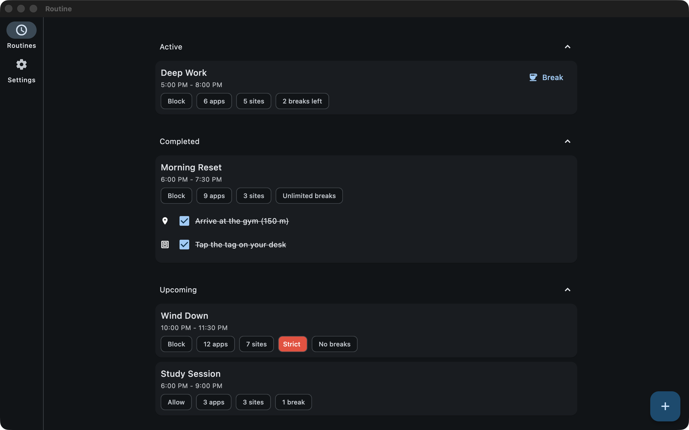
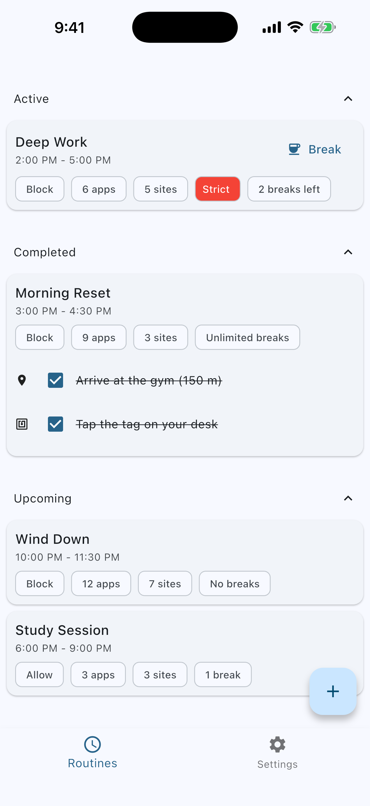
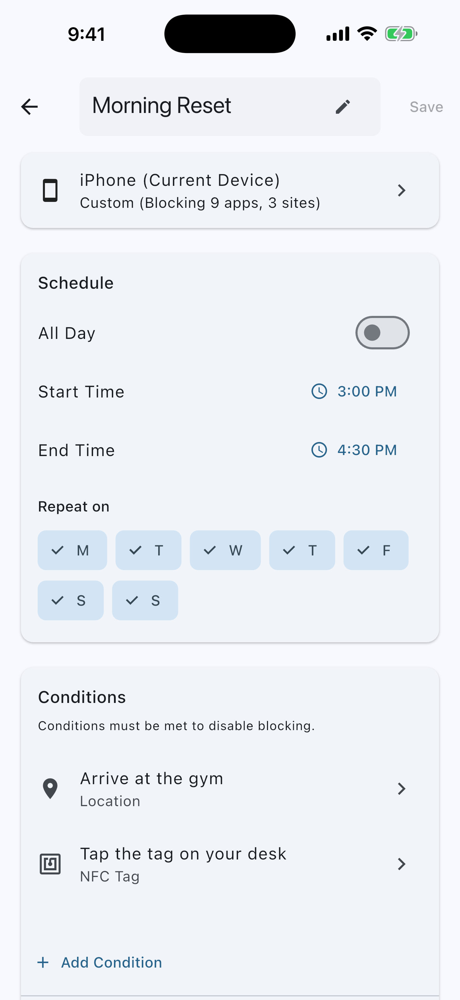
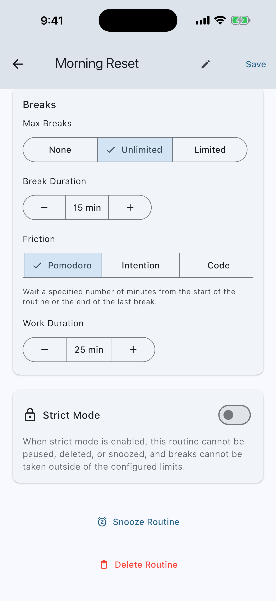
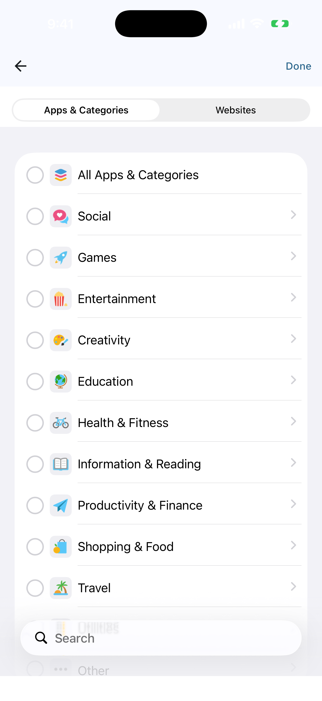
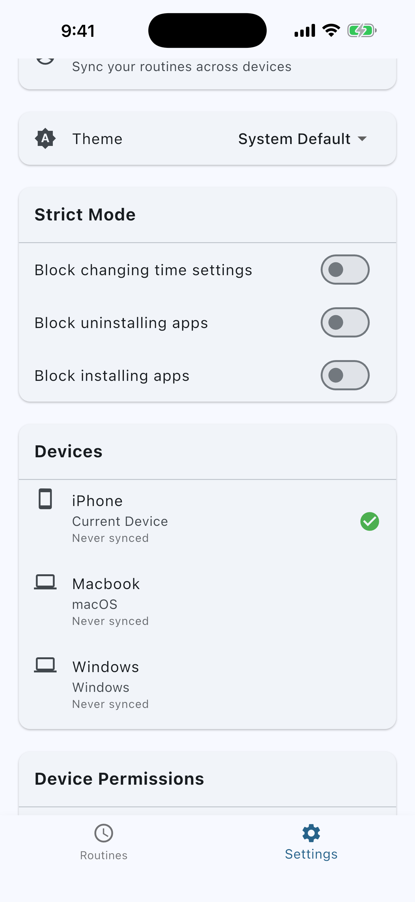
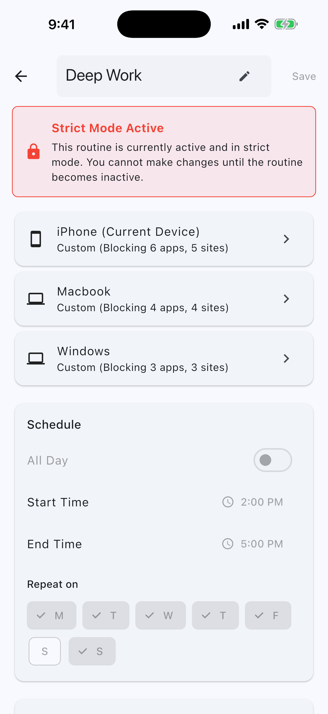
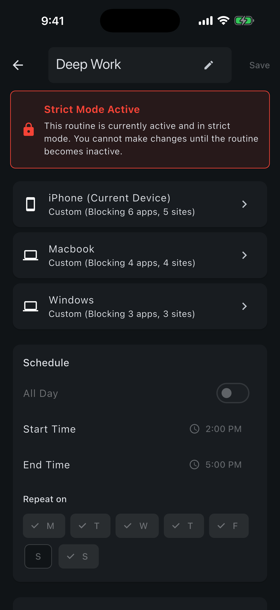

# Routine

App/site blocker for iOS, Android, macOS, and Windows.

## Features

- **Cross-platform:** Works across (almost) all your devices and can automatically sync changes you make to your routines. 
- **Conditions**: Allows you to define special conditions on lists like needing to visit a location or scan an NFC tag/QR Code before unlocking your apps, allowing you to incentivize good habits like going to the gym.
- **Local-First**: Runs offline-first with optional remote sync. Specifically blocked apps/sites never leave your device.
- **Flexible**: Supports both block and allow lists and multiple active lists at the same time. 
- **Strict**: Provides options to add friction to modifying routines and common bypass methods like the task manager or settings changes. 

## Screenshots



| Routines | Schedule & conditions | Breaks & strict mode |
| --- | --- | --- |
|  |  |  |

| Apps & categories | Blocked websites | Settings |
| --- | --- | --- |
|  |  |  |

| Light | Dark |
| --- | --- |
|  |  |

## Support

### Platforms

| Platform | Supported | Minimum Version | Tested 
| -------- | ------- | --------------- | ----- 
| macOS    | ✅      | 13.5           | 14.6.1      
| iOS      | ✅      | 16             | 18.4.1      
| Windows  | ✅      | 10             | 11 Version 24H2      
| Android  | ✅      | 8              | 16 (Emulator)
| Linux    | 🚧      |                |       

### Browsers

| Browser | macOS | Windows | Android | iOS |
| ------- | ----- | ------- | ------- | --- |
| Firefox | ✅ | ✅ | ✅ | ✅ |
| Google Chrome | ✅ | ✅ | ✅ | ✅ |
| Microsoft Edge | ✅ | ✅ | ✅ | ✅ |
| Safari | ✅ | ➖ | ➖ | ✅ |
| Opera | ✅ | ✅ | ✅ | ✅ |
| Brave | ✅ | ✅ | ✅ | ✅ |
| Samsung Internet | ➖ | ➖ | ✅ | ➖ |
| DuckDuckGo | ➖ | ➖ | ✅ | ✅ |
| UC Browser | ➖ | ➖ | ✅ | ➖ |
| Vivaldi | ➖ | ➖ | ✅ | ➖ |

### Known Issues
- Android strict mode settings are brittle due to reliance on identifying specific text fields which may be different across devices.
- English-only. Routine is not localized.

## Development

Docs are WIP - please open an issue if you think something needs further explanation. 

Routine is a Flutter application. Business logic and UI is written in Dart with platform-specific blocking logic written in Swift (MacOS, iOS), Kotlin (Android), C++ (Windows). 

To get started with Routine development, follow [Flutter Get Started](https://docs.flutter.dev/get-started/install) for the platform(s) you'd like to develop for. `flutter run` works as usual for iOS and Android.

### Building the desktop apps

Desktop builds need a step Flutter doesn't know about: the browser extension talks to the app through a **native messaging host**, a small Dart binary that has to be compiled and injected into the app bundle. It is deliberately not a pubspec asset, so `flutter build` alone produces an app where browser blocking silently does nothing.

Use [`just`](https://github.com/casey/just) instead, which handles it:

```sh
just build macos      # or: linux, windows
```

`just --list` shows everything available.

### iOS and MacOS
iOS and MacOS development will require an [Apple Developer account](https://developer.apple.com/programs/enroll/) due to required entitlements (Family Controls, etc.).

Building the macOS app on its own does not — the native messaging host is signed ad-hoc when no Developer ID certificate is present, which is fine for a local build.

### Windows
Builds fail on Windows when firebase_core is included, because its CMake step downloads the C++ SDK. `just build windows` works around this automatically, commenting the Firebase code out for the build and restoring it afterwards.

To do it by hand, `.\clean_windows.ps1` comments the Firebase code out and `.\clean_windows.ps1 -Uncomment` restores it. Run the restore before committing.

### Supabase
Cross-device sync is performed via Supabase. Credentials for this are provided via a .env file in the root directory, refer to .env.example. If you don't have a Supabase project setup, you can simply duplicate and rename .env.example to .env. Empty values are fine.

Sync backend can be found in `./supabase` including an sql setup script and edge function source. It's multi-tenant but will work fine with a single user (you). 

### Firebase
Mobile notifications and background sync requests are sent through Firebase Cloud Messaging (FCM). If you don't have a Firebase project, you can duplicate and rename the firebase_options.example.dart file to firebase_options.dart for local development.

### Browser Extension
Routine performs site blocking on desktop through a browser extension (`./browser/extension`). Communication with the extension is performed via TCP socket using a [native messaging host (NMH)](https://developer.chrome.com/docs/extensions/develop/concepts/native-messaging) (`./browser/native`). This requires a working Dart toolchain which you should have from the Flutter setup.
